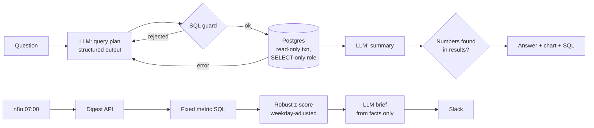

# Meridian

**An AI data analyst for PostgreSQL.** Non-technical teammates ask questions about live
operational data in plain English and get the answer, a chart and the SQL behind it, safely,
with the database never at risk. Every morning it also sends leadership a short brief of the key
metrics with anomalies highlighted.

**Live demo:** https://meridian-analyst.onrender.com (free tier: the first load after idle can
take about a minute)

> "Which region had the highest failed transaction rate last week?"
> → *West Africa, at 15.9%, roughly five times the other regions.* Bar chart, table, and the
> exact read-only SQL that produced it.

## The problem

Operational questions ("why did failed payments jump?", "how many sign-ups yesterday, by
channel?") usually wait in an analyst's queue, while giving everyone database access is unsafe.
And the numbers leaders need every morning are assembled by hand, or not at all.

## What it does

| | |
|---|---|
| **Ask** | Natural language → validated, read-only SQL → answer, chart, table, CSV |
| **Daily digest** | Revenue, transactions, failed-payment rate, sign-ups and churn vs their normal range; anomalies flagged; a short brief written from the computed facts |
| **Automation** | An n8n workflow (included) runs the digest every weekday at 07:00 and posts to Slack: an alert channel if anything is anomalous, a routine channel otherwise |
| **MCP server** | Claude Desktop / Claude Code can use the same safe tools (`ask`, `run_query`, `list_tables`, `describe_table`, `daily_digest`) |



## Safety: three independent layers

1. **SQL guard** (`meridian/sqlguard.py`, sqlglot AST): one statement only; must be a query;
   no INSERT/UPDATE/DELETE/DDL anywhere in the tree (including data-modifying CTEs); no
   `SELECT INTO` or row locks; no dangerous functions (`pg_sleep`, `pg_read_file`, `dblink`,
   `set_config`, ...); only allow-listed tables (no system catalogs); a row limit is always
   applied. 38 tests cover these cases.
2. **Read-only execution**: every query runs in `SET TRANSACTION READ ONLY` with a statement
   timeout.
3. **Least-privilege role**: the app connects as `meridian_reader`, which only has SELECT grants
   and `default_transaction_read_only = on`. An integration test proves writes fail even when
   the guard is bypassed.

Errors from layers 1–2 are fed back to the model, which repairs its query (up to 3 attempts).

## Reliability and honesty

- **Semantic layer:** metric definitions (revenue, failed rate, churn, active MRR) are given to the
  model, so the same question always means the same calculation.
- **Number grounding:** every figure in a generated answer or brief is checked against the
  result set / computed facts. Answers flag untraceable numbers; the digest refuses to publish a
  model brief containing them and falls back to a deterministic template.
- **The digest never depends on the model:** metrics and anomalies are computed with fixed SQL
  and statistics (median/MAD robust z-score, weekday-adjusted so weekends are not "anomalies").
  If the model is down, the template brief still goes out.
- **Provider-agnostic:** Anthropic Claude or Google Gemini behind one interface (`LLM_PROVIDER`),
  with refusal fallbacks, model auto-discovery, quota rotation and typed errors.

## Demo data

`db/seed.sql` generates 120 days of data for **Lumio Pay**, a fictional African payments company
(6 regions, ~6,000 merchants, ~120,000 transactions) with trend, weekly seasonality and noise,
plus three planted incidents the digest should catch:

- West Africa mobile-money payments fail far more often in the last 6 days (`issuer_unavailable`)
- sign-ups jump ~70% on the latest day
- growth-plan cancellations rise after a price change

## Run it

```bash
uv venv && uv pip install -e ".[dev]"
cp .env.example .env          # DATABASE_URL (read-only role) + GEMINI_API_KEY or ANTHROPIC_API_KEY

psql "$OWNER_URL" -f db/schema.sql -f db/seed.sql -f db/readonly_role.sql

meridian web                  # http://127.0.0.1:8000
meridian ask "Which region had the highest failed transaction rate last week?"
meridian digest               # prints today's brief as Markdown
meridian mcp                  # MCP server over stdio
```

**Claude Desktop / Claude Code:** add an MCP server with command `meridian` and argument `mcp`,
with `DATABASE_URL` and a model key in its environment.

**n8n:** import `n8n/daily-digest.json`, set the URL to your deployment, create a Header Auth
credential (`X-Access-Token`) and a Slack credential, then activate.

**Deploy:** the `Dockerfile` serves the app on `$PORT` (Render, Railway, Fly.io). Set
`DATABASE_URL`, an LLM key and `MERIDIAN_ACCESS_TOKEN`.

## Tests and evaluation

```bash
pytest -q                     # unit + API tests; Postgres integration tests run when
                              # TEST_DATABASE_URL is set (CI starts a Postgres service)
python evals/run_eval.py      # execution accuracy on evals/nl2sql_cases.yaml (real model calls)
```

The eval runs the model's query and a reference query and compares results, reporting accuracy,
how often the repair loop was needed, and cost.

## Project layout

```
meridian/
  sqlguard.py     AST-based read-only validator
  db.py           read-only executor, schema introspection (column comments = data dictionary)
  analyst.py      NL→SQL with repair loop, semantic layer, grounded summaries
  digest.py       metrics, anomaly detection, grounded brief with template fallback
  llm.py          Claude / Gemini provider layer
  web.py          FastAPI app; static/index.html is the UI
  mcp_server.py   MCP tools
  state.py        question and digest history (SQLite)
db/               schema, seed, read-only role
n8n/              scheduled digest workflow
evals/            NL→SQL eval set and runner
tests/            unit, API and Postgres integration tests
```

Photography: Christina @ wocintechchat.com via [Unsplash](https://unsplash.com).
